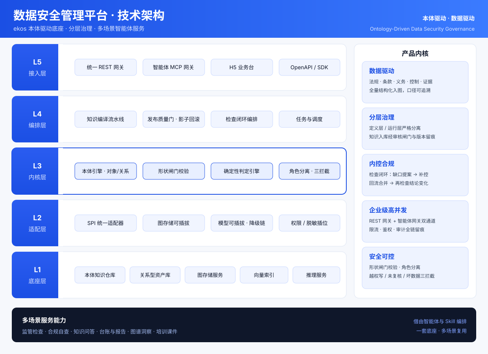
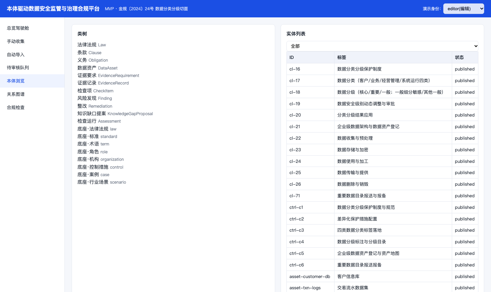
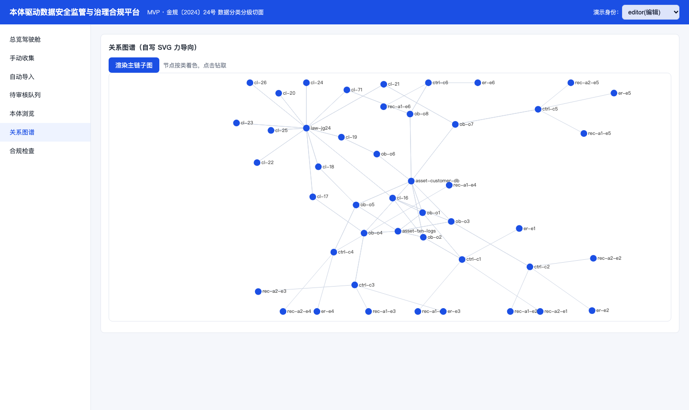
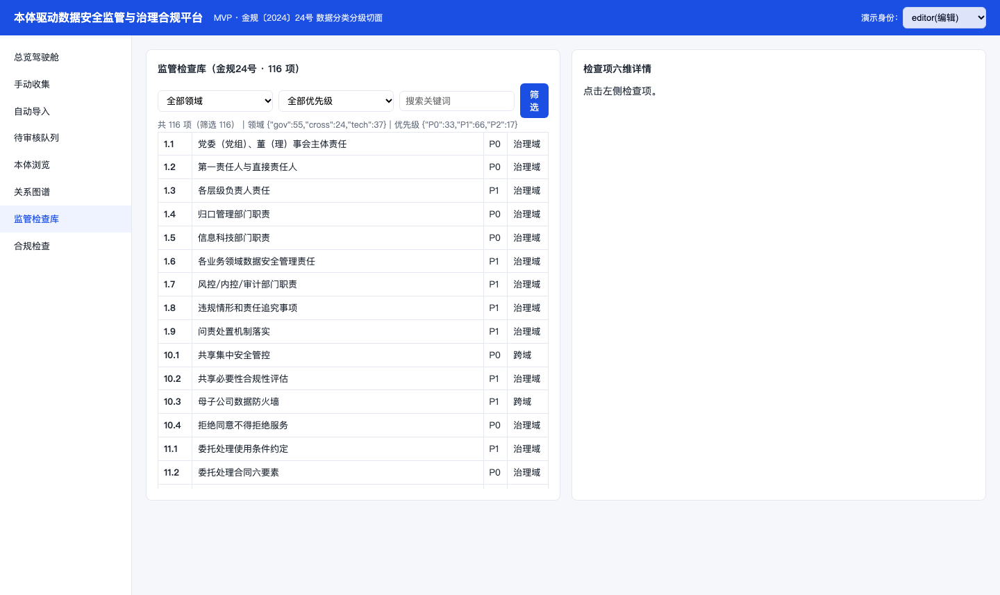
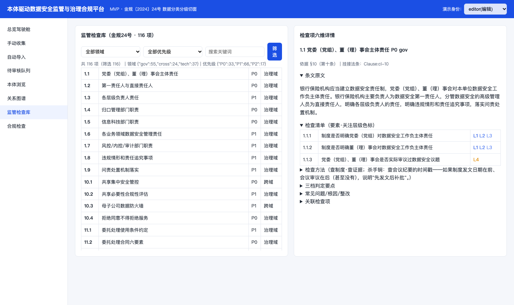
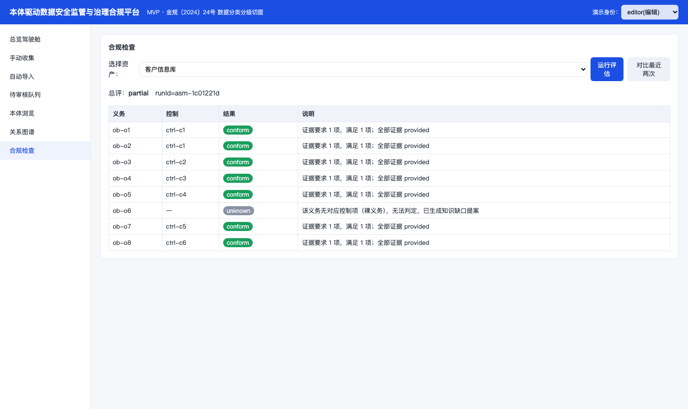
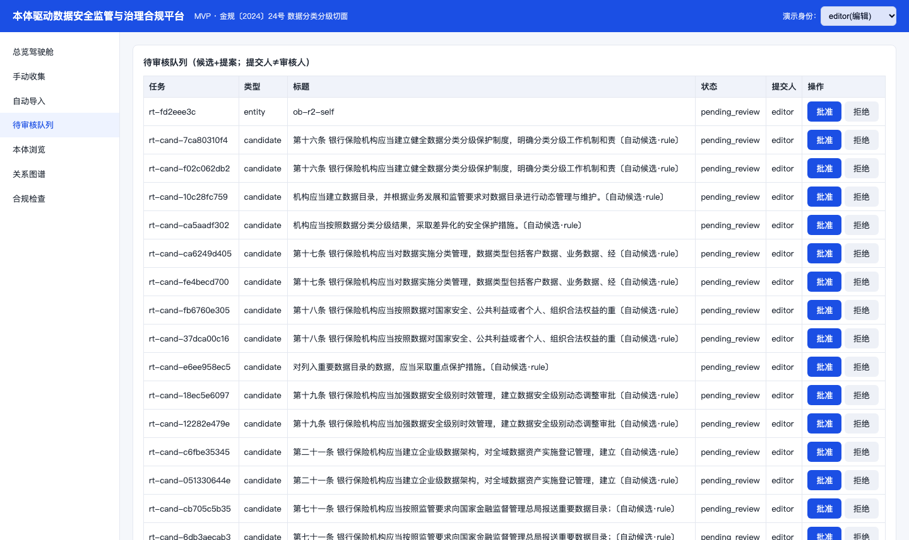

# 数据安全管理平台 · OntoRegGov

> **本体驱动的数据安全监管与治理合规平台**
> 以 **ekos 底座** 为核心，把监管法规、行业标准、控制措施与合规证据编译成一张**可计算、可判定、可追溯的知识网络**，
> 通过智能体（Agent）与技能（Skill）编排，面向**监管检查、机构自查、知识问答、台账与报告、图谱洞察、培训赋能**等多场景提供统一服务能力。

一句话：**把"凭什么判、判什么、怎么改"沉淀为可复用的知识与能力底座，一套底座支撑多场景智能合规服务。**

---

## 一、产品内核

| 内核 | 含义 | 平台落地 |
|---|---|---|
| **数据驱动** | 一切结论来自结构化知识与真实数据，而非主观判断 | 法规→条款→义务→控制→证据全量结构化入图入仓；判定结果逐条溯源，可审计、可复算 |
| **分层治理** | 定义层与运行层分离，知识资产"入库即受控" | 检查定义（知识）与检查运行（记录）严格分域；知识入库经审核闸门 + 版本留痕，运行结果不污染权威知识 |
| **内控合规** | 判定—整改—复检形成闭环，缺口自动回流 | 检查闭环：缺口提案 → 补控制 → 回流合并 → 再检查结论变化；每步留痕可追溯 |
| **企业级高并发** | 双通道对外服务，能力可被系统与智能体大规模调用 | REST 网关（8420）+ 智能体网关（8422）双通道；鉴权、限流、审计全链内建 |
| **安全可控** | 结论确定性、写权限受控、数据不越界 | 确定性判定引擎 + 形状闸门校验；角色分离；越权写 / 未复核 / 坏数据三重拦截 |

---

## 二、技术架构



架构分为五层，能力与流程正交，开源组件与自研逻辑之间以适配层隔离：

- **L5 接入层**：统一 REST 网关、智能体网关（Agent/Skill 调用）、H5 业务台、OpenAPI/SDK。
- **L4 编排层**：知识编译流水线、发布质量门（影子彩排 + 失败自动回滚）、检查闭环编排、任务与调度。
- **L3 内核层（差异化护城河）**：本体引擎（对象 / 关系 / 动作 / 能力）、形状闸门校验、确定性判定引擎、角色分离与三重负向拦截。
- **L2 适配层**：统一 SPI 适配器契约，图存储 / 模型 / 权限 / 脱敏按配置插拔，换实现不动上层。
- **L1 底座层**：本体知识仓库、关系型资产库、图存储服务、向量索引、推理服务。

> 平台**不是通用企业知识库**，而是**监管治理的知识内核**：语义（是什么）+ 动力（能做什么）兼备，
> 上层由智能体与 Skill 编排成多场景服务。

---

## 三、核心能力

### 1. 本体知识底座（语义 + 动力）
- 11 类实体（术语 / 法规 / 标准 / 控制 / 案例 / 方案 / 场景 / 角色 / 指南 / 专题 / 组织）+ 21 类关系，形成法规↔条款↔义务↔控制↔证据的语义网络。
- 本体四要素齐备：**对象（Object）、关系（Link）、动作（Action）、能力（Function）**；动作只写运行命名空间，绝不回写权威知识。
- 知识以**确定性编译**方式由编辑源生成统一口径的知识图，同输入同输出、可重复、可审计。

### 2. 监管检查语义层（多文号）
- 已落 **344 项监管检查**：金规〔2024〕24号 116 项、金办发〔2025〕93号 140 项、人行令〔2025〕3号 56 项、金发〔2026〕8号 32 项。
- 每项含**六维**：检查要点 / 要素（L1 制度、L2 机制、L3 流程、L4 证据、L5 度量）/ 方法步骤 / 访谈问题 / 判定规则 / 常见问题。
- 支持按领域、优先级、文号、关键词多维筛选与六维详情钻取。

### 3. 检查闭环（判定 → 缺口 → 补控 → 复检）
- 选被查对象 + 检查项 → 逐要素录制度/证据/实际值 → 符号引擎聚合出 **pass / partial / fail** 三色结论 + 逐条 why 溯源。
- 不达标自动沉淀**知识缺口提案** → 专家在审核队列接受并补全 → 重跑同一检查，可见**前后结论变化**（如 fail→pass）。

### 4. 知识入库审核闸门
- 外部同步 / 本地学习产生的候选经**入闸审核**（批准 / 拒绝）后合并入库；未复核的智能体候选**不得**进入正式知识。
- 全流程 audit 留痕，配合版本化与字段级 diff。

### 5. 多路检索与知识问答
- 统一检索整合**关键词 / 向量 / 图谱 / 法规库**多路召回，实体详情展示类型、级别、状态、别名、标签、官方来源与关系链。
- 法规问答支持**带文号 / 条号引用**的溯源回答。

### 6. 智能体网关（MCP）
- 平台能力以标准智能体协议对外暴露，**13 个工具**（控制缺口、控制对齐、检查详情、发起检查、登记结果、检查台账、计划清单、图后端、图查询、检索、按文号取检查项、93号文问卷、法规问答），支持外部智能体/系统按同一协议互调。

### 7. 场景化应用（配置驱动）
- 内置两大场景：**被监管方**（金规24号 + 93号文自查/迎检工具）与**监管方**（监管检查工具·金规24号）。
- 场景由注册表配置驱动，新增场景只需追加配置条目，不动核心代码。

### 8. 数据库资产层与网关产品化
- 权威知识抽出独立关系型资产库（实体 / 关系 / 控制 / 检查 / 要素 / 条款 / 自查细项等表），与知识图同源对账。
- 读源支持**三态回落**（资产库 → 知识图 → 本地种子），任一路断链自动降级、服务不中断；网关内建认证、限流、审计。

---

## 四、系统界面

| 本体浏览 | 知识图谱 |
|---|---|
|  |  |
| **监管检查库（多文号）** | **检查项六维详情** |
|  |  |
| **合规评估（三色判定 + why 溯源）** | **待审核队列与缺口提案** |
|  |  |

---

## 五、快速开始

平台零外部云依赖，**无模型密钥也能完整跑通**（智能抽取自动降级为确定性规则抽取，响应标注 `degraded=true`）。

```bash
# 本地一键启动（建/复用虚拟环境 → 安装依赖 → 幂等种子 → 起服务）
bash run.sh
```

启动后：

- 业务台：`http://127.0.0.1:8420/`
- API 前缀：`/api`（健康检查 `/api/health`）
- 智能体网关：`:8422`（`streamable-http`）
- **OpenClaw 智能体服务（v1.18.0 合规自查引擎）**：`http://127.0.0.1:18789`（loopback + Bearer token），
  整合于 `services/openclaw/`（构建产物 + 专属 `openclaw.json` + 专属 `state/` 状态目录），随平台启动自动拉起，
  也可手工 `services/openclaw/start-gateway.bat`。合规自查全部判定逻辑由该智能体完成；
  每注册用户在同一 gateway 进程内自动获得专属 agent（轻隔离），未注册访客共用 `default` agent。

```bash
# 容器方式（推荐，复用本机既有中间件，不新造）
docker compose -f deploy/docker-compose.ontoreggov.yml up -d --build
```

---

## 六、目录结构

```
OntoRegGov/
├── app/                 # 主代码包（FastAPI 应用）
│   ├── main.py          # 应用入口（挂静态台 + /api）
│   ├── services/        # 业务服务（检查/台账/评估/提案/版本/审计/检索路由…）
│   ├── ontology/        # 本体模型与形状定义
│   ├── kb_compiler/     # 确定性知识编译器
│   ├── adapters/        # 统一 SPI 适配器（图存储/模型/权限/脱敏）
│   ├── mcp_server/      # 智能体网关
│   ├── scenarios/       # 场景函数库（配置驱动）
│   ├── web/static/      # H5 业务台（零 CDN，自写 SVG 图谱）
│   └── data/            # 运行时数据（已 gitignore）
├── data/checks/         # ★ 种子数据（入库）：多文号检查项 JSON + 缺口清单
├── deploy/              # 容器编排（Dockerfile + compose）
├── scripts/             # 运维与验收脚本（种子/编译/一致性/发布/报告）
├── ingest/  tools/      # 检查项 ETL 与构建工具
├── samples/             # 演示样例与消费演示页
├── assets/              # README 架构图与系统截图
├── README.md / CHANGELOG.md / ROADMAP.md
└── requirements.txt / run.sh / start.sh
```

---

## 七、工程文档位置（文档与代码分离）

本项目采用**工程文档与工程代码分离**的管理模式：

- **工程代码**：本仓库 `OntoRegGov`（源码、部署、种子数据、脚本）。
- **工程文档**：设计、调研、验收报告、交付证据等已归档至工作台目录
  `/Users/FYP/Documents/@西北人的成长/10-Projects/职业项目/数据安全管理平台/03_平台工程/`
  （含 `design/` `docs/` `research/` `reports/` `evidence/`，以及平台归类规则与索引）。

> 代码注释中出现的 `docs/xx`、`reports/xx` 为历史引用，对应文档以上述工作台目录为准。

---

## 八、接口速览

- 健康与本体：`GET /api/health`、`/api/ontology/classes`、`/api/vocab`
- 实体与图谱：`/api/entities`、`/api/entity/{id}`、`/api/search`、`/api/graph`、`/api/graph/sparql`
- 抽取与审核：`/api/documents/upload`、`/api/extract`、`/api/review/queue`、`/api/ingest/review`
- 知识缺口与提案：`/api/proposals`
- 监管检查：`/api/checks`（多文号筛选）、`/api/checks/{code}`（六维）、`/api/inspection/runs`（+ results / compare / report）、`/api/control` 缺口 `/api/controls/gaps`
- 场景与导出：`/api/scenarios`、`/api/scenarios/{id}/functions/{fid}`、`/api/export/turtle`、`/api/export/shapes`

---

## 九、诚实边界

- 法规元数据（全称 / 文号 / 发布施行 / 官方来源）经权威公开信息核实；
  **控制项、判定口径、证据要点为依据条文的演示性落地改写**，非监管原文要求，正式落地前须由合规专员按正式文本复核。
- 结论（合格 / 部分 / 不合格 / 缺口）始终由**确定性判定引擎 + 形状校验**给出，模型仅产出带置信度与出处的候选。
- 平台仅对权威知识做**只读投影**，绝不回写上游知识资产。
