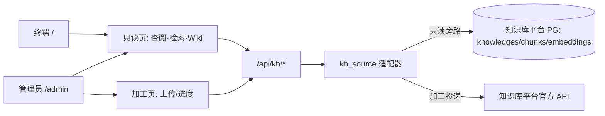

# 路线图（本轮已做 vs 后续）

## 本轮（v1.19.0 · 合规自查 · 智能体自主取证，已交付）

**目标（需求驱动）**：合规自查由"前端逐要素录入 + 后端符号引擎判定"改造为**全部检查逻辑由后端 OpenClaw 智能体完成**；并按"用智能体就让它干智能体的活"原则，证据的相关性判断、文件读取、图片视觉识别、音频转写、语义判定全部由智能体在会话内自主完成，平台只做编排（列目录 → 下发任务 → 收结果 → 落库 → PDF）。

- **v1.18.0（OpenClaw 智能体版）**：模块改造为智能体驱动；`openclaw` 整合为独立服务（`services/openclaw/`，含专属 `openclaw.json` + `state/` 状态目录，监听 `127.0.0.1:18789`），随平台启动自动拉起；新端点 `/api/users/register|login`、`/api/selfcheck/runs*`、`/api/selfcheck/agent/status`；原符号引擎 `/api/inspection/*` 保留不动。
- **v1.19.0（智能体自主取证）**：移除 v1.18.0 的程序化预处理层（关键词挑文件 / Python 库抽文本 / MaaS 视觉·ASR 转写）；新增 `services/openclaw/evidence-kit/`（自包含 venv，供智能体经 exec 调用：office/PDF/zip 逐字抽取、音频本地 faster-whisper 转写）；结果新增 `readFiles`（智能体实际取证清单 = 审计轨迹）；前端与 PDF 报告新增"智能体自主取证 N 份文件"轨迹行。
- **用户 ↔ 智能体一一映射（轻隔离）**：注册用户在同一 gateway 进程内创建专属 agent（独立 workspace / 会话库），未注册访客共用 `default` agent；创建失败自动降级，永不抛错。
- **测试文件集**：`samples/selfcheck-evidence/`（13 个虚构文件，覆盖 pass/partial/fail/missing 预期案例）。

## 本轮（v1.17.0 · MS6 知识库能力开放，已交付）

**目标（PRD `docs/11` M11 / O6）**：把知识库平台的**加工 / 查阅 / 检索 / Wiki** 四类能力开放给终端用户；界面用**平台原生页面**承载，**知识库平台零改造**（不碰其源码 / 页面 / 库结构）。

- **角色（无鉴权下的入口级隔离）**：`/` 终端只读（查阅 / 检索 / Wiki）；`/admin` 管理员可加工。页面内**无角色选择器**；加工写操作审计 actor=`ui-admin`。
- **Wiki 业务分类映射**：平台侧 `app/data/kb_taxonomy.json` 维护 `type 前缀（中/英）→ 业务分类`（默认 法规依据 / 检查项 / 术语 / 控制措施 / 案例 / 标准，另有 方案 / 机构 / 场景 / 专题 / 路径 / 角色 / 指引 等扩展分类），未命中归 `fallback`（默认"其他"）；**分类集合与顺序以该文件为准，改分类不动知识库**。
- **接口（统一信封 `{content, source, fetchedAt, version?}`）**：
  - `GET /api/kb/wiki/tree`（按业务分类聚合的 Wiki 目录树，先于 `{pageId}` 注册）
  - `GET /api/kb/wiki/{pageId}`（既有，页面正文）
  - `GET /api/kb/search`（既有，融合检索）
  - `POST /api/kb/ingest`（知识加工：投递文档 / 正文）
  - `GET /api/kb/ingest/{knowledgeId}`（加工进度：解析 / 分块 / 向量化）
  - `GET /admin`（管理入口页，应用层不鉴权，边界交给网络层）
- **加工写路径（守红线 1）**：平台 BFF → **知识库平台官方 API**（`POST …/knowledge/manual`）→ 由知识库平台自行解析 / 分块 / 向量化 → 平台轮询其状态回显。**平台不直写知识库库表、不落库处理态**（避免二次副本，D5）。
- **前端**：`index.html` 去 `/kb/` 静态内嵌（关闭 G2），改原生「知识库（查阅 / Wiki）」「知识检索」两页；新增 `admin.html`（含「知识加工」）；四类页面均标注取数来源与时间。

## 本轮（v1.8.0，已交付）
- **数据库统一管理资产层（任务线3 工作包 A/B）**：`docs/09` 设计定稿（ER 9 表 + 迁移台账 + 三态读源契约）；
  复用 OrbStack 既有 `wren-postgres`（15432）建独立库 `ekos_ds_kb`（DSN 入 `app/config.py`，未动 test 默认库）。
  新命令：`scripts/db_migrate.py`（up/status/rollback <n>，幂等，回滚 checksum `9316fe95…`）、
  `scripts/db_seed_kb.py`（整批重建幂等、三连跑计数一致）。
- **9 表入库实测计数**：kb_entity 1113 / kb_relation 7860 / control 104 / inspection_check 129（金规116+93号文13）/
  check_element 483 / law_clause 57 / doc93_selfcheck_item 139 / doc93_report_entry 0（空表就绪）/
  schema_migrations 1。pgvector 未启用（宿主 plain pg15-alpine 仅 plpgsql，向量列预留）。
- **网关产品化（任务线3 工作包 C）**：`app/services/db_kb.py`（PG 只读投影，与 canonical_kb 同形）+
  `app/services/kb_read.py`（json→canonical→db 三态回落路由器）；`app/main.py` 增 `gateway_guard` 中间件
  （复用 MCP 侧 Allowlist/RateLimiter，不新造认证；审计落 audit_log）；`/api/entity|search|controls` 切 kb_read、
  `/api/checks/{code}` 三态回落（db→canonical→SQLite）；MCP `dsec_check_detail` 先走 kb_read 并顺带修复
  v1.7 closed-connection 暗伤。新命令：`scripts/smoke_v18_gateway.py`。
- **实测基线**：db 真读 /api/controls total=104、/api/checks/1.1 source=db（gov/P0/cl-10/要素3）、
  /api/search?q=ABAC 命中3、q=党委 db 0 命中自动回落 canonical(total=3)；断链 health=False 自动回落 200 不中断；
  无/坏 token 401、白名单 200、限流与审计通过；Fuseki:3030 ds 图 19,927 三元组可达、RAGFlow:13080 只读连通。
- **决策落盘**：D7 数据库统一管理选型（复用 wren-postgres / PG15-alpine / pgvector 不启用 / DB_READ_FROM 默认 json /
  8430 预留），见 `docs/08-EKOS对齐决策记录.md`。

## 本轮（v1.7.0，已交付）
- **适配层 SPI 收口（B1）**：`app/adapters/`（base/registry/retriever/llm/policy/masker）+ `config.ADAPTERS` 配置段
  （env `ADAPTER_*` 可覆盖）；`scripts/smoke_adapters.py` 实测 6 适配器注册、memory↔oxigraph 切换一致、
  LLM 无 key 降级、旧路径兼容。
- **kb-publish 发布流水线（B3 通道）**：`scripts/kb_publish.py` 影子工作区 `.kb-publish/shadow/` → 控制对账 →
  质量基线门 → build → kb_compile --check → 提升 site-preview → 失败自动回滚；`--demo-edit/--bad-edit/--rollback/
  --strict-zero/--no-reconcile`。实测三处命中 + 非法编辑被拦截回滚。
- **全量知识编译（B2 主体）**：solution33/guide4/topic7 + 金规 116 检查/470 要素/56 Clause 全量 canonical 化；
  三元组 13,881→20,425，幂等 md5 `1360810b…`，SHACL conforms，CSV/TBox 漂移 0（control-codes.csv 已补码到 104 行）。
- **缺口闭环机制（B4 机制就绪）**：`scripts/align_controls.py` 默认 dry-run、`--apply` 写回；实测 0 自动对齐 /
  13 待补（2 条标题待人工对齐：机房物理安全防护→CT-NW-017、同意管理系统功能→CT-PROTO-014；11 条 csv 未建）。
- **决策落盘**：D1–D6 按默认选项拍板，见 `docs/08-EKOS对齐决策记录.md`。

## 本轮（v1.6.0，已交付）
- 93号文（law + topic + 13 自查检查项）编入 canonical；接入层最小 API（/api/entity/{id}、/api/search、
  /api/controls）；消费演示页 samples/ekos_consumer_demo.html；三元组 13,526→13,881。

## 本轮（v1.5.0–v1.5.1，已交付）
- 确定性本体编译器 `app/kb_compiler/`（编辑源 → canonical RDF/OWL+SHACL，幂等）；`KB_READ_FROM=json|canonical`
  feature flag；真接 ontology.yaml + control-codes.csv 权威源并双向对账（CSV/TBox 漂移 0）；运行期 SHACL
  CheckResultShape 缺陷修复。

## 本轮（v1.4.0，已交付）
- 图存储后端升级：memory / oxigraph / fuseki（标准 SPARQL 层，可插拔，Fuseki 容器化已实测）；
  API /api/graph/backend|sync|sparql；scripts/smoke_graphstore.py 三后端全断言通过。
- 远程 MCP 服务：app/mcp_server（FastMCP 1.x，stdio+streamable-http，Bearer allowlist 鉴权），
  9 个平台工具；MCP_PORT=8422。

## 本轮（v1.3.0，已交付）
- 多人检查台账与周期复查：检查计划（周期）、多人分工（assignees）、证据归档、复核签署、台账聚合、下次复查日期推算。
- demo: scripts/demo_ledger.py；API: /api/inspection/plans|ledger|runs/{id}/evidence|signoff。

## 本轮（v1.2.1，已交付）
- 阈值自动判定泛化：中文比较词/句内嵌阈值/分数/全覆盖/零/抽样比例/中文频次，多目标与定性保持 manual。
- 回归测试 scripts/test_thresholds.py（49 用例）；形态可解析率 35.4%→69.3%。

## 本轮（v1.2.0，已交付）
- 控制清单正式对齐 10 工程 v1.5：48 条占位 → 35 条 aligned（CT 码 + mapsToFormalControl）/ 13 条缺口反馈。
- 底座快照按 v1.5 重投影（91 control / 218 term）；config.KB_ROOT 迁移后修正为绝对路径。

## 本轮（v1.1.2，已交付）
- 控制词汇单一事实源对齐：权威 Control=10 工程 v1.5 CT 编码体系，本平台不造 CT 码。
- 移除检查侧 9 条→内部演示 ctrl-c* 的伪对齐（O6 义务演示闭环保留）。
- 新增 `dsec:ControlPlaceholder` 控制需求占位层（48 条：45 缺口 / 3 暂定），suggestsControl 覆盖 116。

## 本轮（v1.1.0，已交付）
- 在 v1.0.0 分类分级切面之上，把金规24号**全量 116 项监管检查**落为定义层知识库（InspectionCheck 语义层）。
- 定义层/运行层分清：检查定义（TBox）与 InspectionRun/CheckResult（运行结果）分开。
- P0 纵切：符号引擎三档聚合 + why 溯源 + 缺口反哺（复用既有提案/审核/版本/audit）。
- 法条复用 Clause（RegulationArticle≅Clause），补建缺失法条；mapsToTerm/mapsToControl 对齐底座。
- 前端"监管检查库"视图（筛选/六维详情/图谱钻取）。

## 本轮（v1.0.0，已交付）
- 一个"面"：金规24号数据分类分级 §16–19/21/71 切面，2 资产，端到端闭环。
- SQLite + RDFLib 内存图（由已发布版本物化，变更重建）+ pySHACL 闸门。
- 规则抽取为主、OpenAI 兼容 LLM（无 key 降级）。
- 7 视图 H5、自写 SVG 图谱、版本化、audit_log、角色分离。

## 后续路线图（代码不实现，仅规划）

### 下一步（任务线2 已就绪后的收尾项）
| 方向 | 说明 | 前置/替换点 |
|---|---|---|
| 13 缺口清零 | 知识侧按 `reports/align-report.json` 补码 11 条 + 人工对齐 2 条标题措辞（机房物理安全防护→CT-NW-017、同意管理系统功能→CT-PROTO-014），随后 `python scripts/align_controls.py --apply` | 机制已就绪（v1.7.0），等知识侧 csv |
| ~~质量门收紧到 0/0~~ ✅ v1.13.1 | `kb_publish.py` 质量门默认终态：要求字面 ERROR=0/WARN=0，回归即拦截回滚；`--allow-baseline` 保留"基线无回归"过渡模式（知识侧仍有已知告警时用） | 实测默认门通过 0/0 |
| ~~B3 消费端正式切换~~ ✅ v1.15.0 | base_import 退役 base-snapshot 手工副本（改统一走 canonical 编译器）、只读 API 默认切读 canonical/db；MCP/REST SPARQL 工具加命名空间 ACL（`assert_readonly`，禁 UPDATE/禁写 kb 图） | 已切默认 `KB_READ_FROM=canonical`、`DB_READ_FROM=db` |
| 116 检查 richer 层入 canonical | Metric 342 / InterviewQuestion 243 / InspectionMethodStep 705 / VerdictRule / FindingPattern 从 SQLite 种子推广进 canonical.ttl | 现仅 CheckItem+Element+Clause canonical 化 |
| 93号文检查项现场检查化 | 若 93号文附件2 的 139 项要做成可执行 InspectionCheck，单独建模（决策 D5 已记，用户可改） | 现以 topic 正文承载 |
| ~~**全量 richer 层入库（db 资产层）**~~ ✅ 线A | 已新建 richer 层 5 表（`check_metric` 342 / `check_method_step` 705 / `check_interview` 243 / `check_verdict_rule` 116 / `check_finding_pattern` 285，外键 `inspection_check(check_code) ON DELETE CASCADE`），并补投影缺失：检查标题、`check_element.text`、`law_clause.text` | v1.8 已入 9 表（entity/relation/control/check/element/clause/doc93item），richer 细层已补齐 |
| ~~**kb_publish 挂接 step_load_db**~~ ✅ 线A | 发布流水线在三道质量门后加 `step_load_db`（门4）：影子比对通过后自动跑 `db_migrate up` + `db_seed_kb`，db 资产层随 canonical 发布同步整批重建（库不可达仅告警不阻断）；`--skip-db` 可跳过 | 已实测随发布自动刷新 |
| ~~**pgvector 启用评估**~~ ✅ v1.14.0 | 评估两条路：① 把 ekos-postgres（自带 pgvector 0.8.0）换到未占用端口启动；② 在 wren-postgres 内装 vector 扩展。启用后才灌 embedding、开语义检索 | 实测 15432 宿主即 `ekos-postgres`（pgvector 0.8.0 / pg16），资产层 `kb_embedding`/`law_chunk` 已 100% 非空（344/344），"启用评估"无需再做 |
| ~~**知识底座语义向量化补齐**~~ ✅ v1.14.0 | 底座 526 篇 manual 文档停留 `draft` 未分块/未向量化，`weknora_vector` 路由近乎空转 | 新增 `scripts/weknora_reparse_batch.py` 批量重解析；实测 chunks 90→3508 / embeddings 84→3502（12→526 篇，768 维，覆盖率→100%），`/api/search` 语义路实测打通 |
| ~~**DB_READ_FROM 灰度切默认 / B3 正式切源**~~ ✅ v1.15.0 | 已把 `DB_READ_FROM` 默认从 json 切到 **db**、`KB_READ_FROM` 切到 **canonical**；并完成 B3 消费端正式切源（退役 base-snapshot 手工副本、只读 API 全量切读 canonical/db） | v1.8 三态回落已通（db→canonical→SQLite）；实测 PG 投影健康、canonical 对账一致（controls=115），三态冒烟全绿 |

### 中长期（原规划表）
| 方向 | 说明 | 前置/替换点 |
|---|---|---|
|---|---|---|
| ~~对接 10 工程 v1.5~~ ✅ v1.2.0 / 缺口机制 ✅ v1.7.0 | 已消费 v1.5 全量控制清单与 CT 编码，35/48 占位正式对齐（mapsToControl + CT 码）；control-codes.csv 已补码到 104 行（EP15/NW17/SVC30/PROTO14/MGMT28）；二次对齐脚本 `scripts/align_controls.py` 已就绪（dry-run 默认） | 剩余 13 条缺口见 `data/checks/控制缺口清单.md` 与 `reports/align-report.json` |
| 更多办法导入 | 把其他监管办法/检查清单走同一 ETL→checks_import 流程批量入库 | 现有 checks_import 幂等可复用 |
| ~~阈值自动解析泛化~~ ✅ v1.2.1 | 已扩展：中文比较词/句内嵌阈值/分数/全覆盖/零/抽样比例/中文频次；多目标与定性保持 manual（见 test_thresholds.py） | 余下定性形态按 manual 处理，积累样例可继续扩规则表 |
| ~~检查计划/台账~~ ✅ v1.3.0 | 已实现：inspection_plans（周期）+ 台账聚合 + 下次复查日期推算 | 复查到期提醒/超期预警可后续加 |
| ~~多人检查流程~~ ✅ v1.3.0 | 已实现：assignees 多人分工、证据上传归档、复核签署（approved/returned） | 签署链多级审批可后续加 |
| ~~远程 MCP 服务端~~ ✅ v1.4.0 | 已实现：app/mcp_server（FastMCP 1.x，stdio+streamable-http，Bearer allowlist，9 工具，端口 8422） | 底座工程可按同一 MCP 协议互调 |
| 知识库网站 | 实体/图谱/评估结果发布为可浏览站点 | 复用 base-snapshot 与导出 ttl |
| ~~Neo4j 适配器~~ 🚧 见部署文档 | 属性图遍历/图算法（社区发现、风险传导多跳） | 适配器接口已定义（sync/query 两函数），Cypher 映射草案见 deploy/README-fuseki-neo4j.md；按需实现 |
| ~~Fuseki / Oxigraph server~~ ✅ v1.4.0 | 标准 SPARQL 端点 + 持久化三元组库；memory/oxigraph/fuseki 三后端可插拔，Fuseki 容器实测通过 | 判定轨道仍走进程内 RDFLib 物化（确定性），存储轨道为 SPARQL 层 |
| LightRAG / GraphRAG | 语义检索增强、自然语言问答 | 现仅关键词/why 溯源；需向量索引 |
| SHACL 1.2 | SPARQL-based shape、裸义务检测正式建模为 shape | 现裸义务在引擎内确定性实现 |
| 风险主动感知 | 实时监测 + 主动预警/持续合规评分 | 现为准入式批量评估 |
| 底座补词 | 责任体系/主体责任、三道防线、数据安全责任制、归口管理 4 主题待底座补 term 后补 mapsToTerm | 现未硬挂 |
| 更多法规切面 | DCMM(GB/T 36073-2025)/DSMM(GB/T 37988-2019)/等保2.0(GB/T 22239-2019) | 复用同一 TBox/判定框架扩样 |

## 标准勘误备忘
- DCMM：旧 GB/T 36073-2018 已于 2026-07-01 被 **GB/T 36073-2025（DCMM2.0）** 代替。
- DSMM = GB/T 37988-2019；等保2.0 = GB/T 22239-2019。
